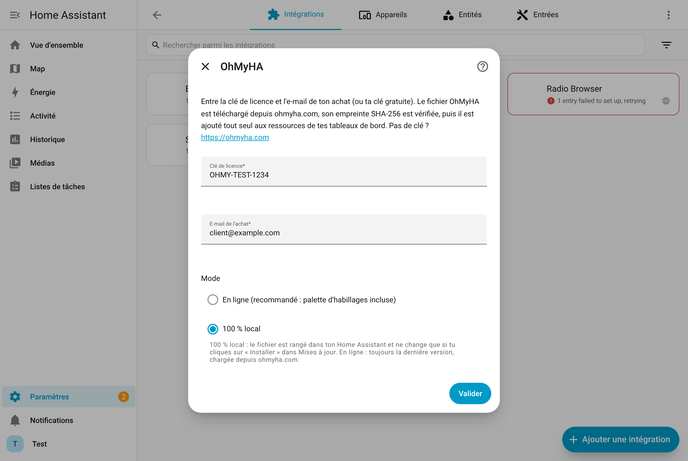
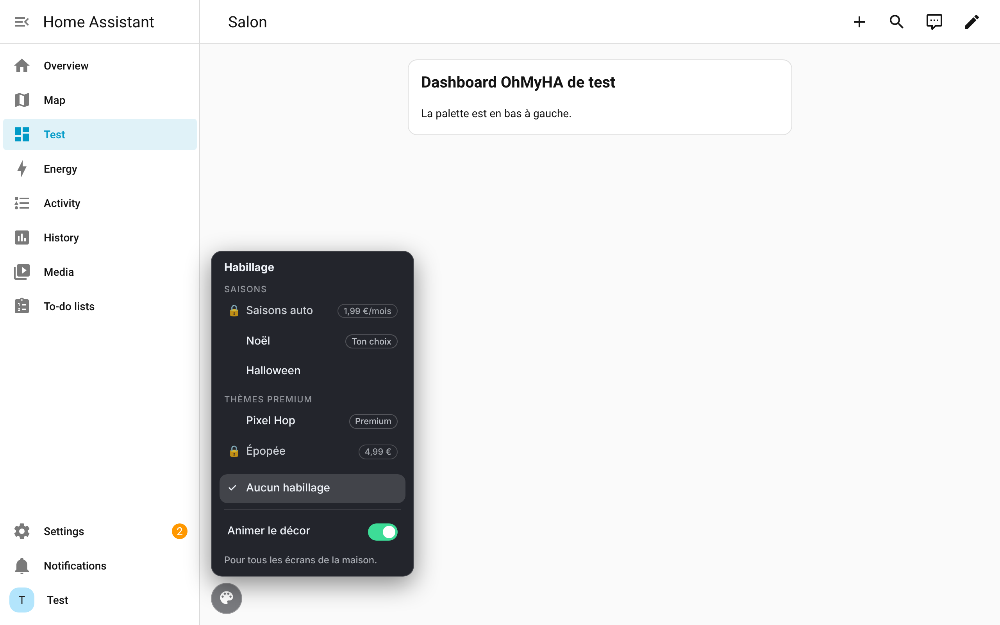

# OhMyHA for Home Assistant

Free integration that installs the **OhMyHA** file in Home Assistant in one step: dashboards designed in the [OhMyHA studio](https://ohmyha.com/studio), themes, seasonal skins, the skin palette and the studio bridge.

## Install
1. Settings > Marketplace (or HACS) > ⋮ > Custom repositories > add `https://github.com/OhMyHAdash/ohmyha-integration`, type **Integration**, then download **OhMyHA** and restart Home Assistant.
2. Settings > Devices & services > Add integration > **OhMyHA**.
3. Enter your OhMyHA licence key and purchase e-mail (or a free key from [ohmyha.com](https://ohmyha.com)), pick a mode, done.
   No key yet? Leave both fields empty: the online version is added, enough to build your dashboard in the OhMyHA studio. Add your key later with **Reconfigure** to switch to 100% local.

## Modes
- **100% local** (recommended): the file is downloaded once, its SHA-256 is checked against the fingerprint published on https://ohmyha.com/local, stored in `/config/ohmyha/` and served by Home Assistant at `/ohmyha_files/ohmyha.js`. It never changes by itself: a new version shows up in **Settings > Updates** (*OhMyHA file*) and is installed only when you click **Install**. Skin palette and the premium skins you own are included.
- **Online**: adds the resource `https://ohmyha.com/ohmyha.js`, always the latest version, loaded from ohmyha.com.

Already added OhMyHA by hand? The integration notices it and asks: keep your install as it is (default), or let the integration manage it (your old resource is put back if you remove the integration).

Removing the integration removes its resource and its file. Nothing else in your Home Assistant is changed.

## Skin palette on any dashboard
Add the card **OhMyHA · habillage et palette** (`custom:ohmyha-palette`) to any dashboard: it reuses the skin of your OhMyHA dashboard and shows the round palette button at the bottom left.

## Licence
The integration is free and open source (MIT). OhMyHA dashboards need an OhMyHA key (a free key exists).
